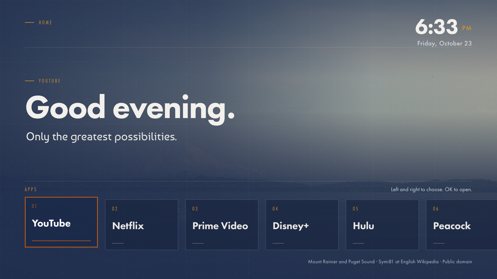
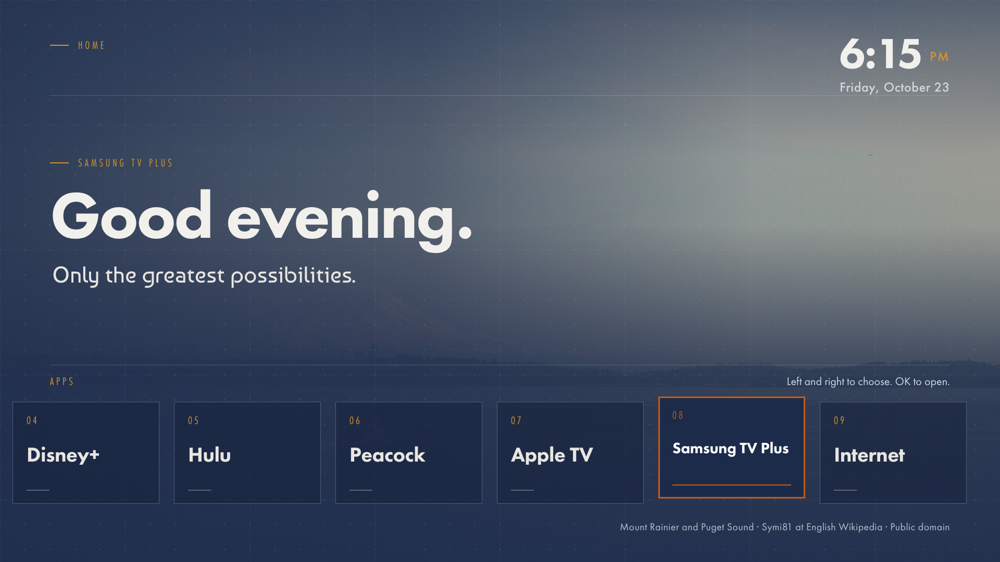
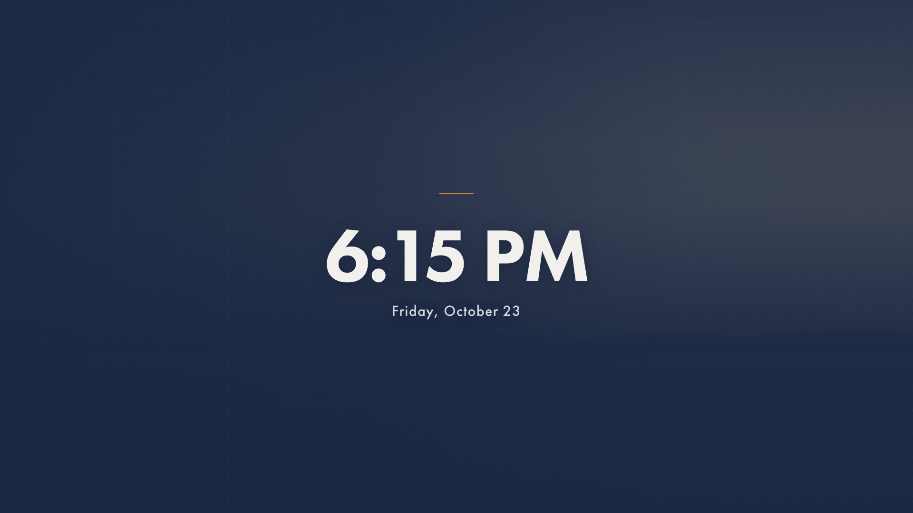
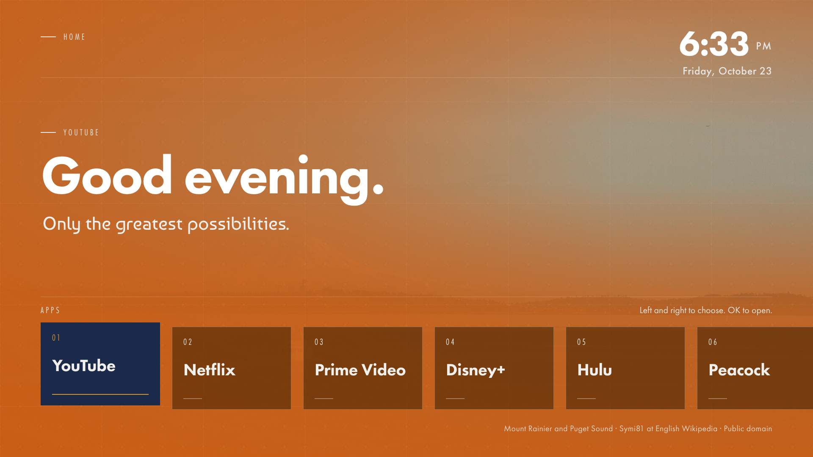
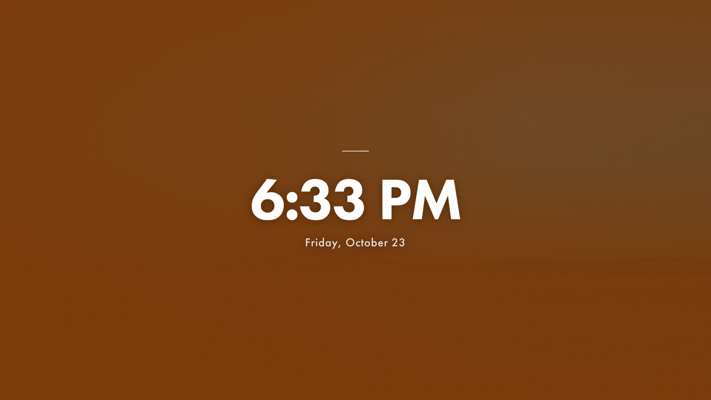

# PNW Home

A calm, type-led home screen for Samsung Tizen TVs: a clock, a numbered dock of your apps, and rotating photos of Mount Rainier, Tacoma and the South Puget Sound. No ads, no tracking, no background service.

[](https://github.com/poyfather/PNW-home/actions/workflows/ci.yml)
[](LICENSE)
[](CHANGELOG.md)
[](#compatibility)



## Why

Samsung's Smart Hub puts promoted tiles and autoplaying previews between you and the three apps you actually open. PNW Home is a plain Tizen web app that the TV can start into instead: your apps in a row, the time, and a good photo of the Pacific Northwest. The look is cassette futurism: a navy ground, hairline grids, a warm tint, Futura PT and Baumans type, one orange accent for the focused tile.

Built and tested on a 2018 UN65NU8000 running Tizen 4.0. The TV's Home button still opens Smart Hub; no app can change that. With **Autorun Last App** on, the TV powers on into PNW Home.

## Quick start

You need a Samsung TV in Developer Mode, Samsung's Tizen CLI, and a free Samsung signing certificate for your TV. [docs/INSTALL.md](docs/INSTALL.md) walks through all three.

1. Copy the environment template and fill in your TV's IP, device ID and signing profile:
   ```sh
   cp scripts/tizen-env.example.sh scripts/tizen-env.sh
   ```
2. Build and sign the package:
   ```sh
   . scripts/tizen-env.sh && scripts/build.sh
   ```
3. Install it on the TV and open it:
   ```sh
   scripts/install.sh
   ```

Then on the TV: **Apps → App Settings → PNW Home → Add to Home**, and under **Settings → General → Smart Features** turn **Autorun Smart Hub** off and **Autorun Last App** on.

## What it looks like

| Home | Dock scrolled | Ambient (after 5 min idle) |
|---|---|---|
|  |  |  |

## Themes

Two colour themes ship in the package. Set `theme: 'navy'` or `theme: 'orange'` in `app/js/config.js`, or preview either with `?theme=orange` on the desktop.

| Navy (default) | Burnt orange |
|---|---|
|  |  |
|  |  |

The orange theme keeps the same layout and type, swaps the ground to burnt orange with cream labels, uses navy as the single cold accent for the focused tile, and drops to anchor brown for the ambient screen.

## Remote

- **Left / Right**: move along the dock
- **OK**: open the focused app
- **Back**: nothing at the top level (this is a home screen)
- Any key wakes the ambient screensaver; that first press does nothing else

## Configuration

Everything lives in [`app/js/config.js`](app/js/config.js):

| Setting | What it does |
|---|---|
| `apps` | The dock, in order. Each entry lists Tizen app IDs to try, then name patterns. `icon: false` shows a type-only tile. |
| `greetings`, `accent` | Hero copy. The greeting follows the time of day; the accent line is one short statement. |
| `theme` | `'navy'` (default) or `'orange'` |
| `locale`, `hour12` | Clock and date format |
| `photos` | Backdrop on or off, manifest path, time between photos |
| `ambient` | Idle time before the screensaver |
| `night` | Evening dimming window |

Find your TV's app IDs with `sdb shell 0 vd_applist` while Developer Mode is on.

<details>
<summary>Adding photos</summary>

Drop a 1920×1080 JPEG into `app/photos/` and add an entry to `app/photos/manifest.json`:

```json
{ "src": "photos/my-photo.jpg", "caption": "Where it is", "artist": "Who took it", "license": "CC0", "source": "https://..." }
```

The caption, artist and licence are shown bottom-right while the photo is up. Keep to works you have the right to redistribute; the bundled set is public domain or CC0 (see [CREDITS.md](CREDITS.md)).
</details>

<details>
<summary>Previewing on a desktop</summary>

```sh
cd app && python3 -m http.server 8765
```

Open `http://127.0.0.1:8765/index.html`. Without the Tizen runtime the dock uses a mock app list. Query flags: `?focus=N`, `?ambient=1`, `?idle=MS`, `?night=1`, `?at=2026-01-01T20:00`.
</details>

## Project layout

```
app/              the Tizen web app (config.xml, index.html, css/, js/, photos/, icon.png)
scripts/          build.sh, install.sh, tizen-env.example.sh
docs/             INSTALL.md and screenshots
.github/          CI, issue forms, PR template, Dependabot
```

## Compatibility

Written for the Tizen 4.0 web engine (Chromium 56 era): ES5, flexbox, CSS variables, no CSS grid. It should run on any Samsung TV from 2018 onward. Only the UN65NU8000 has been tested; please [report](https://github.com/poyfather/PNW-home/issues/new/choose) what you see on yours.

## Contributing

Bug reports, model reports and pull requests are welcome. See [CONTRIBUTING.md](CONTRIBUTING.md). Security concerns go through [SECURITY.md](SECURITY.md), not the issue tracker.

## Credits and licence

Code is [MIT](LICENSE). The app-launch plumbing is adapted from [Glass Home](https://github.com/victaphu/glass-home-samsung-tv) (MIT). Photos are public domain or CC0 works from Wikimedia Commons, listed with their photographers in [CREDITS.md](CREDITS.md). Futura PT is served by Adobe Fonts and Baumans by Google Fonts; neither is redistributed here.
