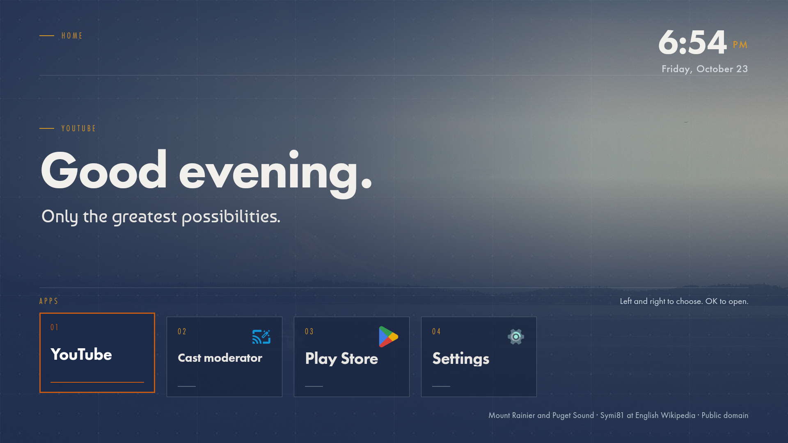

# PNW Home on Android TV, Google TV and Fire TV

One APK covers all three. It is a small Kotlin shell: a full-screen WebView showing the same
web core as the Samsung build (`app/`), plus a JavaScript bridge that lists the TV's installed
apps and launches them. Unlike Tizen, Android lets the app register as a **Home** screen, so
pressing the Home button can open PNW Home directly.

| | Android TV / Google TV | Fire TV |
|---|---|---|
| Install | ADB over the network (Developer options → USB/Network debugging) or a file manager | ADB over the network (Developer options → ADB debugging) or Downloader |
| Appears in | Apps row (Leanback launcher) | Your Apps & Channels |
| Replace Home button | Yes, by disabling the stock launcher (reversible, see below) | No, Amazon locks the launcher. Open it from Your Apps |
| Tested on | Android TV emulator, Android 14 / API 34 (see below) | Not yet tested on hardware |

## Build

Needs a JDK 17 and an Android SDK with platform 34 and build-tools 34. Without Android Studio
the quickest route on a Mac is:

```sh
# JDK 17 (Eclipse Temurin) and Gradle 8.9 into ~/android-toolchain, SDK into ~/Library/Android/sdk
mkdir -p ~/android-toolchain/jdk && curl -sSL "https://api.adoptium.net/v3/binary/latest/17/ga/mac/aarch64/jdk/hotspot/normal/eclipse" | tar -xz -C ~/android-toolchain/jdk --strip-components=1
mkdir -p ~/Library/Android/sdk/cmdline-tools && curl -sSL -o /tmp/clt.zip https://dl.google.com/android/repository/commandlinetools-mac-11076708_latest.zip && unzip -q /tmp/clt.zip -d /tmp/clt && mv /tmp/clt/cmdline-tools ~/Library/Android/sdk/cmdline-tools/latest
export JAVA_HOME=~/android-toolchain/jdk/Contents/Home ANDROID_HOME=~/Library/Android/sdk
yes | $ANDROID_HOME/cmdline-tools/latest/bin/sdkmanager --licenses >/dev/null
$ANDROID_HOME/cmdline-tools/latest/bin/sdkmanager --install platform-tools "platforms;android-34" "build-tools;34.0.0"
```

Then:

```sh
android/build.sh            # -> dist/PnwHome-debug.apk
```

`build.sh` sources `~/android-toolchain/env.sh` if present, runs the Gradle wrapper, and copies
the APK to `dist/`. The Gradle build syncs `app/` into `android/app/src/main/assets/www` first,
so the Tizen and Android packages always ship the same web core.

The debug APK is signed with the local debug key, which is fine for sideloading on your own
TVs. For a release build (`android/build.sh Release`) add a signing config to
`android/app/build.gradle.kts` first.

## Install over ADB

On the TV: Settings → Device Preferences → About → tap **Build** seven times, then Developer
options → **Network debugging** (Android TV) or Settings → My Fire TV → Developer options →
**ADB debugging** (Fire TV). Note the TV's IP address.

```sh
adb connect <TV_IP>:5555        # accept the prompt on the TV
adb install -r dist/PnwHome-debug.apk
adb shell monkey -p org.pnwhome.tv 1   # opens it once
```

### Make it the Home screen (Android TV / Google TV)

PNW Home registers for the HOME intent, but on Android TV that alone is not enough. The stock
launcher declares its HOME filter at priority 2, third-party apps are capped at 0, and Android
picks the higher priority before it looks at the preferred app or the HOME role. Verified on
the API 34 emulator: after `set-home-activity` and even after granting the HOME role to PNW
Home, the Home key still opened the stock launcher.

What works is the same approach the Android TV launcher-replacement projects use: disable the
stock launcher for the current user. It is not uninstalled, and one command brings it back.

```sh
# 1. Record what the stock launcher is, so you can restore it
adb shell cmd package resolve-activity --brief -a android.intent.action.MAIN -c android.intent.category.HOME | tail -1
#    Android TV: com.google.android.tvlauncher/.MainActivity
#    Google TV:  com.google.android.apps.tv.launcherx/...

# 2. Point HOME at PNW Home, then disable the stock launcher (use the package from step 1)
adb shell cmd package set-home-activity --user 0 org.pnwhome.tv/.MainActivity
adb shell pm disable-user --user 0 com.google.android.tvlauncher

# 3. Press Home on the remote. PNW Home should appear. Open an app from the dock and press
#    Home again to confirm it returns.
```

Undo:

```sh
adb shell pm enable --user 0 com.google.android.tvlauncher
adb shell cmd package set-home-activity --user 0 com.google.android.tvlauncher/.MainActivity
```

Keep PNW Home installed while the stock launcher is disabled; if you uninstall it first, Android
falls back to the Settings app's minimal `FallbackHome` until you re-enable the launcher. On
Google TV the launcher also provides the Discover and Live tabs, which disappear with it.

## How the shell works

- `MainActivity.kt` builds a WebView served by `WebViewAssetLoader` from
  `https://appassets.androidapp.com/assets/www/`. A real https origin means `localStorage`
  persists and the Adobe Fonts kit accepts the request.
- D-pad and OK presses are intercepted in `dispatchKeyEvent` and forwarded to the page as
  synthetic key events with the key codes the web core already uses (37 to 40, 13), so
  WebView focus never gets in the way. Back is swallowed, as on a home screen.
- `AppBridge.kt` is `window.PNWAndroid`. `listApps()` returns the Leanback and ordinary
  launcher activities (label, package, 96 px icon as a data URL); `launchApp(pkg)` starts the
  Leanback launch intent, falling back to the ordinary one. The manifest's `<queries>` block
  is what lets it see other apps on Android 11+.
- `app/js/platform.js` picks the Android backend when `window.PNWAndroid` exists. Dock entries
  in `config.js` carry `android` package names next to the Tizen `ids`; anything unmatched by
  package is matched by name.

## Emulator

```sh
sdkmanager --install emulator "system-images;android-34;android-tv;arm64-v8a"
avdmanager create avd -n pnw_tv -k "system-images;android-34;android-tv;arm64-v8a" -d tv_1080p
emulator -avd pnw_tv -no-snapshot -no-audio &
adb wait-for-device && adb install -r dist/PnwHome-debug.apk
adb shell am start -n org.pnwhome.tv/.MainActivity
adb exec-out screencap -p > shot.png
```

## What was verified on the emulator

Android TV, Android 14 (API 34), 1920×1080 at 320 dpi:

- Install and launch; fonts (Futura PT, Baumans) and the photo backdrop load.
- The bridge found YouTube by package and topped the dock up with the other launcher apps.
- D-pad Left/Right move focus; OK launched YouTube; Back on the home screen does nothing.
- With the stock launcher disabled, the Home key opens PNW Home and returns to it from YouTube.
- Re-enabling the stock launcher restores the original Home behaviour.



## Known limits

- Fire TV will not let a third-party app own the Home button.
- App icons come from each app's launcher icon, which on TV is often a square badge rather
  than the wide Leanback banner. Tiles marked `icon: false` in `config.js` show type only.
- The web fonts need internet access the first time; afterwards WebView caches them.
